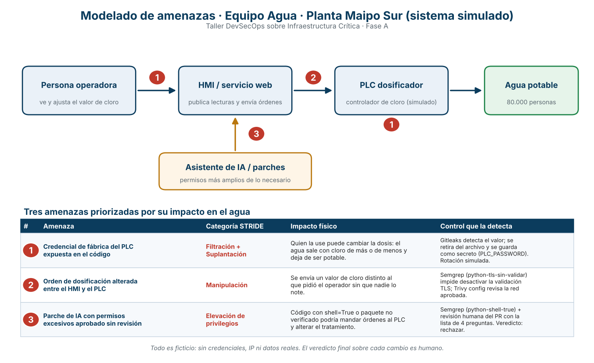

# Ficha de blindaje

## Sistema y equipo
- Sector: Agua potable (planta Maipo Sur, sistema simulado)
Nombre: Agua Potable
- Roles:
  - Operador de planta: Gerardo González
  - Desarrollador: Gerardo González
  - Guardián del pipeline: Ignacio Ibañez
  - Auditor de IA: Ignacio Ibañez
  - Relator: Gerardo González

## Diagrama

## Tres amenazas
1. Credencial de fábrica del PLC expuesta en el código / Filtración + Suplantación / quien la use puede cambiar la dosis y el agua deja de ser potable / Gitleaks la detecta y se guarda como secreto
2. Orden de dosificación alterada entre el HMI y el PLC / Manipulación / se envía un valor de cloro distinto al que pidió el operador / Semgrep (python-tls-sin-validar) y Trivy config
3. Parche de IA con permisos excesivos aprobado sin revisión / Elevación de privilegios / código con shell=True o un paquete no verificado podría mandar órdenes al PLC / Semgrep (python-shell-true) y revisión humana del PR

## Controles
- Enlace a Actions: https://github.com/gerardogonzalez0264gg/planta-maipo-sur-template/actions/runs/38787934314
- Controles ejecutados: Gitleaks, Semgrep, Trivy (dependencias, vulnerabilidades HIGH y CRITICAL) y Trivy (configuración). Todos en verde en la rama equipo-agua, junto con la prueba funcional.
- Resultado de Semgrep: [lo que dijo el paso, por ejemplo "0 hallazgos"]
- Resultado de Trivy dependencias: [lo que dijo]
- Resultado de Trivy configuración: [lo que dijo]
- Acciones de terceros fijadas por SHA completo (checkout, gitleaks-action y trivy-action), no por etiqueta.

## Hallazgo y decisión
- Hallazgo: Gitleaks detectó una credencial escrita directamente en config.yaml (línea 4). El primer run falló por eso.
- Gravedad: Alta (da control sobre el dosificador de cloro)
- Decisión y justificación: Corregir ahora. Se retiró el valor del archivo, config.yaml usa password_env: PLC_PASSWORD y el valor vive como secreto del repositorio. Se simula la rotación: la clave estuvo expuesta, por lo que se considera comprometida. En una planta real se cambiaría en el PLC y se revisarían los accesos recientes.
- Responsable y fecha: [nombre], 15-10-2026

## Parche de IA
Propuesta #7 - arregla la lectura del controlador (PR #1, archivo lector_cloro_ia.py). No se fusionó.
- Paquete verificado: No. plc_helper_utils no existe en PyPI (404, verificado el 15-10-2026), no está en requirements.txt y además se importa sin usarse (línea 5).
- Tratamiento de entradas: Inseguro. subprocess.run("echo " + texto, shell=True, ...) une texto externo a un comando del sistema (línea 12; Semgrep: python-shell-true).
- Protecciones desactivadas: Sí. requests.post(..., verify=False) apaga la validación TLS (línea 15; Semgrep: python-tls-sin-validar).
- Destino de datos: TELEMETRIA = http://telemetria.ejemplo.invalid/datos (línea 7), sin justificación y sin cifrar. Se le envía la salida del comando ejecutado.
- Veredicto y evidencia: RECHAZADO. Combina paquete no verificado, shell con texto concatenado, TLS desactivado y envío de datos injustificado. El PR además no tiene ninguna revisión automática (Checks: 0).
- Explicación para el operador (redactada con IA, revisada por [nombre]): Este parche permite que un texto ajeno se ejecute como comando en el equipo que habla con el controlador, así que alguien podría dar órdenes no autorizadas que alteren la dosificación de cloro. Además envía los datos a un destino sin justificar y con la verificación de seguridad desactivada, por lo que podrían filtrarse o modificarse sin que nadie lo note.

## Pendientes para un sistema real
- Rotar la credencial en el PLC y revisar los accesos de los últimos días.
- Limpiar el historial del repositorio, donde la clave original sigue guardada.
- Agregar el disparador pull_request al workflow para que los cambios se revisen antes de aceptarlos.
- Segundo factor de autenticación y segmentación de red entre HMI y PLC.
- Generar y guardar la lista de materiales del software (SBOM).

## Reproducción
- Workflow: seguridad-planta (Actions → Run workflow, rama equipo-agua).
- Comandos equivalentes en un computador:
  - `semgrep scan --config .semgrep.yml --error .`
  - `PLC_PASSWORD=valor-de-prueba PYTHONPATH=. python scripts/prueba_funcional.py`
